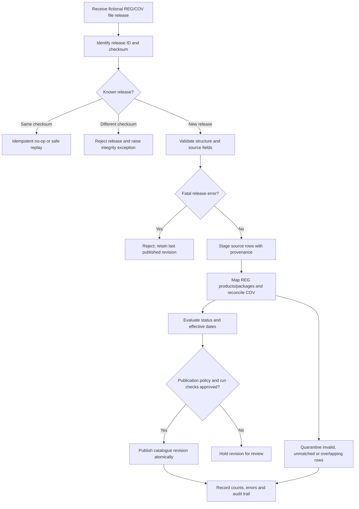

# Proposed Import and Reconciliation Flow

**Status:** `DESIGN CANDIDATE`. Partial publication with quarantined rows is **OPEN (`DEC-03`)**; neither branch claims real implementation or execution.

See [data flow and synchronization](../05_data_flow_and_synchronization.md) and [validation and errors](../06_validation_and_error_handling.md).
