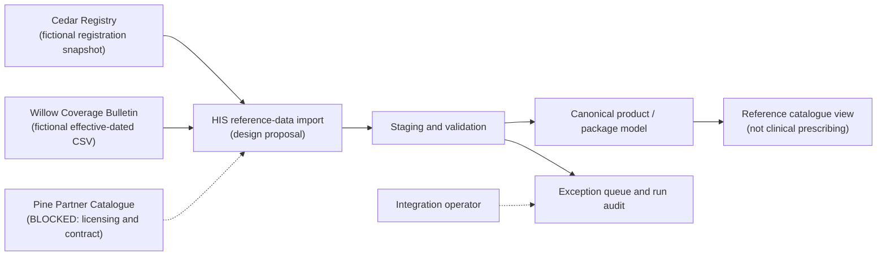

# System Context – Fictional Medication Reference Data

**Legend:** Solid arrows are **proposed** data flows. Dotted arrows indicate **unimplemented/unverified** dependencies or human review. No service shown is a real vendor API.

See [integration context](../01_integration_context.md) and [source contracts](../02_source_systems_and_contracts.md).
